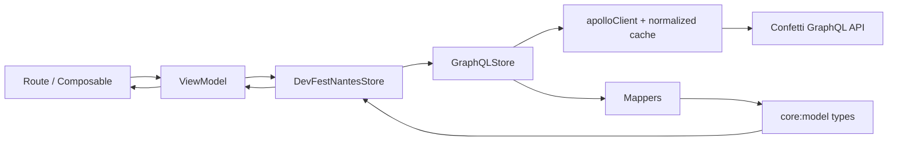

# DevFest Nantes - Architecture Guide

This document describes how the DevFest Nantes app is structured: the Gradle modules, how data flows
from the GraphQL API to the screens, and the conventions that keep the modules independent.

## Table of Contents

- [Overview](#overview)
- [Module Graph](#module-graph)
- [Layers](#layers)
- [Data Flow](#data-flow)
- [Dependency Injection (Koin)](#dependency-injection-koin)
- [Navigation](#navigation)
- [State Management](#state-management)
- [iOS App](#ios-app)
- [Privacy and Data Collection](#privacy-and-data-collection)
- [Conventions and Constraints](#conventions-and-constraints)

## Overview

The app is a **Kotlin Multiplatform** project. Data, domain, network and analytics code lives in
KMP modules (`commonMain`) and is shared with iOS through the `shared` framework. The Android UI is
built with Jetpack Compose and split into one Gradle module per feature. The iOS UI is written in
SwiftUI and consumes the shared framework.

```
┌──────────────────────────────────────────────────────────────────────────┐
│ :androidApp  MainActivity (NavHost), DevFestNantesApplication, app Koin  │
├────────────┬────────────┬────────────────┬──────────┬────────┬───────────┤
│ :feature:  │ :feature:  │ :feature:      │ :feature:│:feature│ :feature: │
│ agenda     │ speakers   │ session-detail │ venue    │ about  │ settings  │
└─────┬──────┴─────┬──────┴───────┬────────┴────┬─────┴───┬────┴─────┬─────┘
      ▼            ▼              ▼             ▼         ▼          ▼
┌──────────────────────────────────────────────────────────────────────────┐
│ :core:ui  Compose theme, shared components, BookmarksViewModel (Android) │
└───────────────────────────────┬──────────────────────────────────────────┘
                                ▼
┌──────────────────────────────────────────────────────────────────────────┐
│ :core:domain  Shared agenda policies and use cases (KMP), domainModule   │
└───────────────────────────────┬──────────────────────────────────────────┘
                                ▼
┌──────────────────────────────────────┐   ┌─────────────────────────────┐
│ :core:data  DevFestNantesStore (KMP) │   │ :core:analytics (KMP)       │
│  GraphQLStore / mocked store,        │   │  AnalyticsService,          │
│  BookmarksStore                      │   │  PerformanceMonitoring      │
└──────────────────┬───────────────────┘   └─────────────────────────────┘
                   ▼
┌──────────────────────────────────────────────────────────────────────────┐
│ :core:network  Apollo GraphQL client + schema (KMP)                      │
│ :core:model    Plain domain types + fixtures (KMP)                       │
└──────────────────────────────────────────────────────────────────────────┘

 :shared  KMP framework for iOS, single Koin entry point `initKoin()`
 iosApp/  SwiftUI app consuming the `shared` framework
```

## Module Graph

Modules are declared in `settings.gradle.dcl`:

| Module | Type | Purpose |
|---|---|---|
| `:androidApp` | Android app | Activity, `NavHost`, application initializers, app-level Koin modules |
| `:shared` | KMP (exported to iOS) | `initKoin()` composition root, `IosDependencies` for Swift |
| `:core:model` | KMP | Domain types (`Session`, `Speaker`, `Room`, `Agenda`, ...), `stubs/` fixtures, `WebLinks` |
| `:core:network` | KMP | Apollo client, normalized cache, GraphQL schema and operations |
| `:core:domain` | KMP | Shared agenda policies and use cases (`ClassifySessionUseCase`), `domainModule`; exported by `:shared` |
| `:core:data` | KMP | `DevFestNantesStore` facade, `GraphQLStore`, mocked store, `BookmarksStore` |
| `:core:analytics` | KMP | `AnalyticsService`; Android Firebase analytics and performance implementations |
| `:core:testing` | KMP | Fakes, `MainDispatcherRule`, test doubles Koin modules |
| `:core:ui` | Android library | Compose theme, shared components, app bars, `BookmarksViewModel` |
| `:feature:agenda` | Android feature | Agenda pager, session filters drawer |
| `:feature:speakers` | Android feature | Speaker list and details |
| `:feature:session-detail` | Android feature | Session details, OpenFeedback form |
| `:feature:venue` | Android feature | Venue info and floor plan |
| `:feature:about` | Android feature | About screen, partners |
| `:feature:settings` | Android feature | Settings, legal, data-collection consent |

Build configuration is shared through convention plugins in the included build `build-logic/`
(`devfest.android.application`, `devfest.android.feature`, `devfest.android.library`,
`devfest.android.koin`, `devfest.kmp.library`, `devfest.detekt`).

Dependency direction is one-way and acyclic:
`androidApp → feature:* → core:ui → core:domain → core:data → core:network / core:model`.
Feature modules never depend on each other.

## Layers

### App shell (`:androidApp`)

`androidApp/src/main/java/com/gdgnantes/devfest/androidapp/`

- `MainActivity.kt`: the single activity. Installs the splash screen, enables edge-to-edge, sets the
  theme and hosts the Navigation Compose `NavHost`.
- `DevFestNantesApplication.kt`: starts Koin and runs the application initializers.
- `ui/screens/Screen.kt`: sealed class of typed destinations; `ui/screens/Home.kt` +
  `home/HomeViewModel.kt` for the bottom-bar home.
- `di/AppModule.kt`, `di/AndroidModules.kt`: app-level Koin bindings and the list of Android modules.
- `core/`: `ApplicationInitializer` and its implementations, `CoroutinesDispatcherProvider`,
  Timber trees under `core/logging/`.
- `services/ExternalContentService.kt`: opens URLs (Custom Tabs).

### Feature modules (`:feature:*`)

Each feature lives in `feature/<name>/src/main/java/com/gdgnantes/devfest/feature/<name>/` (the
package drops hyphens: `feature/sessiondetail`) and follows the same layout:

- `<Name>Route.kt`: the public entry composable, which resolves the ViewModel with `koinViewModel()`.
- Screen composables, `<Name>ViewModel.kt`, and optional `components/`, `services/`, `utils/`.
- `di/<Name>Module.kt`: the feature's Koin module.

Side effects that need the app shell (opening URLs, cross-feature navigation, analytics on
navigation) are passed in as lambdas, for example `SessionDetailRoute(onSocialLinkClick = ...)`.

### Shared UI (`:core:ui`)

Material 3 theme (`theme/`), reusable components (`components/`, `components/appbars/`), Compose
helpers (`utils/`), the cross-feature `BookmarksViewModel`, and `di/CoreUiModule.kt`, which defines
the `IO_DISPATCHER` qualifier.

### Domain (`:core:domain`)

`core/domain/src/commonMain/kotlin/com/gdgnantes/devfest/core/domain/`

Business logic shared by Android and iOS, in packages `agenda`, `speakers`, `venue` and `di`. It
depends on `:core:model` and `:core:data` and is exported to Swift through `:shared`.

- Policies and use cases are plain classes with named methods (for example
  `ClassifySessionUseCase.isService`, `isTalk`, `isNavigable`), not `operator invoke` objects.
- They are bound as Koin `factory` definitions in `di/DomainModule.kt`. `domainModule` is
  `@HiddenFromObjC` and is part of `sharedModules`; iOS resolves use cases through
  `IosDependencies`.
- Methods that return a `Flow` carry `@NativeCoroutines` so Swift sees `async`/`AsyncSequence`.
- No public extension functions on exported model types: Swift cannot call them as members.

### Data (`:core:data`)

`core/data/src/commonMain/kotlin/com/gdgnantes/devfest/core/data/`

- `DevFestNantesStore`: the single read facade over conference data. Collections are exposed as
  `Flow`s (`agenda`, `sessions`, `speakers`, `rooms`, `partners`), lookups as `suspend` functions
  (`getSession`, `getSpeaker`, `getRoom` return `null` when not found; `getSpeakerSessions`,
  `getVenue(language)`).
- `DevFestNantesStoreBuilder`: picks `GraphQLStore` or `DevFestNantesStoreMocked`
  (`setUseMockServer(true)`).
- `graphql/GraphQLStore.kt` + `graphql/Mappers.kt`: run Apollo queries and map them to `core:model`
  types. Apollo types never leave this module.
- `BookmarksStore`: persisted bookmarked session ids.

### Network (`:core:network`)

- `Apollo.kt`: the process-wide `apolloClient`, pointing at the
  [Confetti](https://github.com/joreilly/Confetti) backend (`https://confetti-app.dev/graphql`) with
  the `conference: devfestnantes2025` header. It is exposed to Koin as a `single`.
- `ApolloCache.kt`: a 10 MB memory cache chained with a SQLite normalized cache (`apollo.db`), which
  is what gives the app offline access to previously loaded data.
- `src/commonMain/graphql/`: `schema.graphqls`, `extra.graphqls`, `operations.graphql`. Generated
  code lands in `com.gdgnantes.devfest.core.network.graphql`, with data builders enabled for tests.

### Model (`:core:model`)

Plain Kotlin domain types with no internal dependency. `stubs/` holds the canonical fixtures
(`SessionFixtures`, `SpeakerFixtures`, ...) used by previews and tests.

### Analytics (`:core:analytics`)

- `commonMain`: `AnalyticsService`, `AnalyticsEvent`, `AnalyticsPage`, `AnalyticsParam`.
- `androidMain`: `FirebaseAnalyticsService`, and the `performance/` package
  (`PerformanceMonitoring` interface, `FirebasePerformanceMonitoring`, tracing extensions).
  See [PERFORMANCE_MONITORING.md](PERFORMANCE_MONITORING.md).
- `iosMain` binds nothing: iOS analytics and performance are implemented in Swift.

## Data Flow



Example, the agenda:

1. `MainActivity` registers `Screen.Home`; `Home` shows the agenda tab.
2. `AgendaRoute` gets `AgendaViewModel` from Koin. It receives `DevFestNantesStore`, `BookmarksStore`,
   `PerformanceMonitoring`, `SessionFiltersService` and the `IO_DISPATCHER`.
3. The ViewModel combines `store.agenda`, bookmarks and filters into UI state.
4. `GraphQLStore` runs the Apollo query and maps the response through `graphql/Mappers.kt`.
5. `Agenda.kt`, `AgendaPager.kt`, `AgendaColumn.kt` render the state.

Session details: a click navigates to `"${Screen.Session.route}/{sessionId}"`;
`SessionDetailRoute` builds `SessionViewModel` with that id. The OpenFeedback form is shown only when
`BuildConfig.OPEN_FEEDBACK_ENABLED` is true (`OpenFeedbackConfig` is built in the app shell);
otherwise `FallbackFeedbackForm` links to the web form.

## Dependency Injection (Koin)

Every Gradle module owns one Koin module in `di/<Name>Module.kt`. `initKoin()` in
`shared/src/commonMain/kotlin/com/gdgnantes/devfest/shared/di/InitKoin.kt` is the single
composition root:

- It starts Koin with `sharedModules` (network, data, analytics) plus the platform modules it is
  given.
- Android passes `androidModules` (core:ui, the feature modules and the app shell) and
  `androidContext` from `DevFestNantesApplication`.
- iOS calls it with no arguments through `IosDependencies.shared.start()`.
- Overriding is disabled (`allowOverride(false)`): a binding declared twice fails at start-up.

```kotlin
// feature/venue/.../di/VenueModule.kt
val venueModule: Module = module {
    viewModelOf(::VenueViewModel)
}

// androidApp: started once from the Application
initKoin(platformModules = androidModules) { androidContext(this@DevFestNantesApplication) }

// Route composables resolve their ViewModel
val viewModel: VenueViewModel = koinViewModel()
```

Rules:

- ViewModels are plain classes with constructor parameters; parameterized ones use
  `viewModel { (id) -> ... }`.
- Service-locator access (`by inject()`, `KoinComponent`, ...) is limited to `di/` packages,
  `*Module.kt` files, `DevFestNantesApplication`, `MainActivity` and `IosDependencies`.
  `koinViewModel()` is allowed everywhere.
- `scripts/di-gate.sh` enforces this in CI, and forbids any reintroduction of Hilt/Dagger.
- Graph verification runs in CI: `KoinGraphTest` (`:shared`), `*ModuleTest` per module, and
  `KoinStartupTest` / `ProductionGraphStartupTest` (Robolectric) in `:androidApp`.

## Navigation

The Android app uses Navigation Compose with string routes defined in `Screen.kt`
(`home`, `agenda`, `speakers`, `venue`, `about`, `settings`, `session`, `speaker`,
`datacollection`, `legal`). Detail routes append an id: `"${Screen.Speaker.route}/${speaker.id}"`.
To add a screen, add a `Screen` subclass and a `composable(...)` entry in `MainActivity`'s `NavHost`.

## State Management

- ViewModels expose `StateFlow`s; mutable state stays private (`_uiState` + `asStateFlow()`).
- `UiState` (`STARTING`, `SUCCESS`, `ERROR`) lives in `:core:ui`.
- `SessionFiltersServiceImpl` is a Koin `single`, so the agenda and `HomeViewModel` share the same
  filters.
- Bookmarks are persisted by `BookmarksStore` and shared through `BookmarksViewModel`.
- Coroutine dispatchers are injected (`CoroutinesDispatcherProvider`, `IO_DISPATCHER`) so tests can
  replace them.

## iOS App

`iosApp/iosApp/` is a SwiftUI app (deployment target iOS 17.0):

- `iOSApp.swift` configures Firebase, then calls `IosDependencies.shared.start()` to start Koin.
- `Model/BaseViewModel.swift` gets the store from `IosDependencies.shared.store()`. Flows are
  consumed through KMP-NativeCoroutines (Combine / async sequences).
- Feature code is in `Agenda/` and `UI/` (`Speakers/`, `Venue/`, `About/`, `Common/`).
- `Analytics/FirebaseAnalyticsService.swift` and `Performance/PerformanceMonitoring.swift` call the
  Firebase iOS SDK (Swift Package Manager) directly.
- `SwiftGen/` generates typed assets and strings; `Resources/` holds `en.lproj` and `fr.lproj`.

The Kotlin framework is built by the Xcode build phase
`./gradlew :shared:embedAndSignAppleFrameworkForXcode`.

## Privacy and Data Collection

On Android, Firebase Analytics, Crashlytics and Performance are under user control:

- `DataCollectionSettingsService` (`feature/settings/.../services/`) stores the enabled services in
  `SharedPreferences` and toggles `setAnalyticsCollectionEnabled`,
  `isCrashlyticsCollectionEnabled` and `isPerformanceCollectionEnabled`.
- `DataCollectionAgreementDialog` asks for consent on first launch; `DataCollectionSettingsScreen`
  lets the user change it at any time.
- At start-up, the initializers run in a fixed order (named Koin list in `di/AppModule.kt`):
  `DataSharingInitializer` (applies stored consent), `OpenFeedbackInitializer`,
  `PerformanceInitializer`. Note that `PerformanceInitializer` currently re-enables performance
  collection unconditionally (see [PERFORMANCE_MONITORING.md](PERFORMANCE_MONITORING.md)).

iOS does not have a consent screen yet.

## Conventions and Constraints

- **Adding a store method:** add it to `DevFestNantesStore` and implement it in both
  `GraphQLStore.kt` and `DevFestNantesStoreMocked.kt` in the same change. The shared
  `DevFestNantesStoreContractTest` runs against both.
- **Global state:** `apolloClient` is a process-wide value in `:core:network`, not created per graph.
- **Errors:** missing entities are `null` from the store; Flow errors are caught in the data layer and
  surface as `UiState.ERROR` where handled. Logging uses Timber on Android
  (`TimberTreeDebug` / `TimberTreeRelease`).
- **No authentication:** the API is public and the app has no user accounts.

## Related Documentation

- [DEVELOPMENT.md](DEVELOPMENT.md) - Environment setup, build, test and tooling
- [PERFORMANCE_MONITORING.md](PERFORMANCE_MONITORING.md) - Firebase Performance on Android and iOS
- [VERSIONING.md](VERSIONING.md) - Calendar versioning
- [iOS_BUILD_DSYM.md](iOS_BUILD_DSYM.md) - iOS release builds and dSYMs
